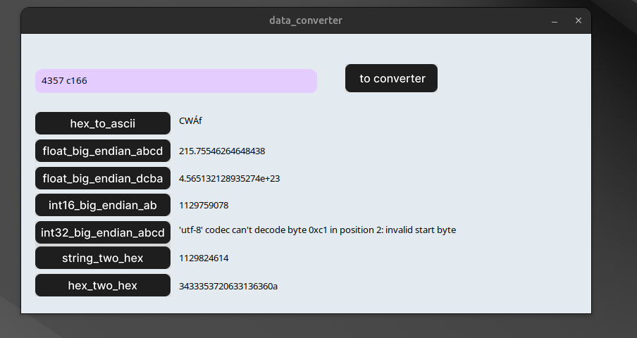

# Data Converter

Calculadora desktop para converter valores lidos de equipamentos industriais e medidores de energia, como registradores Modbus e respostas em hexadecimal. Você digita o valor uma vez e vê o resultado em todos os formatos ao mesmo tempo.



## Conversões

| Conversão | O que faz | Exemplo |
|---|---|---|
| `HEX_TWO_ASCII` | Hexadecimal para texto ASCII | `414243` → `ABC` |
| `FLOAT_BIG_ENDIAN_ABCD` | Hexadecimal para float de 32 bits, big endian (ABCD) | `41200000` → `10.0` |
| `FLOAT_LITTLE_ENDIAN_DCBA` | Hexadecimal para float de 32 bits, little endian (DCBA) | `00002041` → `10.0` |
| `INT16_BIG_ENDIAN_AB` | Hexadecimal para inteiro de 16 bits com sinal, big endian | `FFFF` → `-1` |
| `INT32_BIG_ENDIAN_ABCD` | Hexadecimal para inteiro de 32 bits, big endian (aceita espaços) | `0001 0000` → `65536` |
| `STRING_TWO_HEX` | Texto para hexadecimal | `Oi` → `4f69` |
| `HEX_TWO_STRING` | Hexadecimal para texto UTF-8 | `4f69` → `Oi` |

## Como rodar

Precisa só do Python 3 com Tkinter, sem bibliotecas externas.

```bash
# Ubuntu/Debian: instala o Tkinter, se ainda não tiver
sudo apt install python3-tk

# na pasta do projeto
python3 -m src.main
```

No Windows, o instalador oficial do Python já vem com o Tkinter.

## Estrutura

```
src/
  main.py             interface gráfica (Tkinter)
  classConversion.py  funções de conversão
assets/               imagens da interface
```
